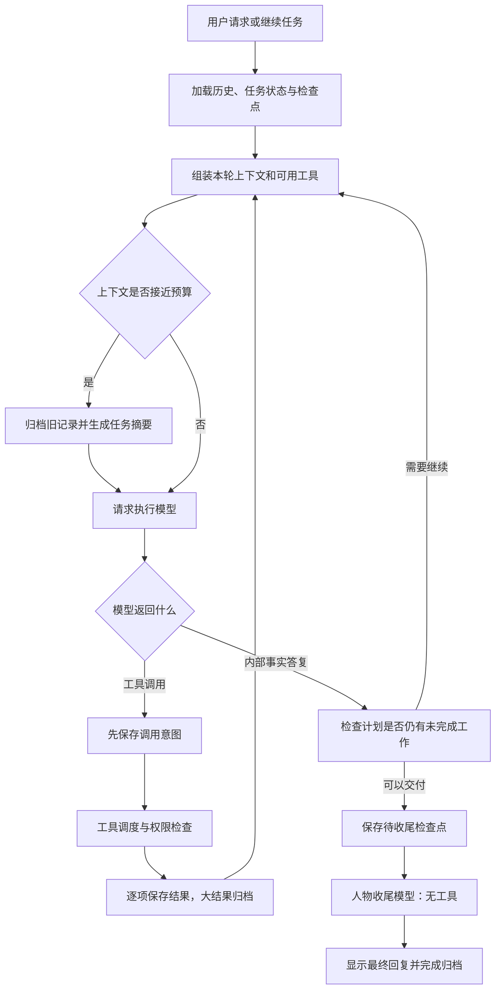

# Capri Agent 架构说明

本文对应 2026 年 10 月 29 日的第一版内核重构，供项目阅读与讨论使用。英文原版见 [AGENT_HARNESS.md](AGENT_HARNESS.md)。

## 这次重构做了什么

Capri 借鉴 Hermes Agent，把任务执行循环、工具调度、上下文压缩和可恢复任务计划拆成独立模块，用 Kotlin 接回现有 Android 应用。

这里的 **harness** 可以理解为“支撑模型做事的运行框架”：它负责把合适的信息和工具交给模型，执行工具调用，保存进度，处理失败与恢复，并决定何时进入最终回复。

本次没有把 Hermes 的 Python 程序装进手机，也没有直接替换整个应用。Android 原生工具、文件、浏览器、终端、MCP、权限和人物表达仍由 Capri 提供。当前实现借鉴了 Hermes 的架构机制，不代表已经拥有 Hermes 的全部功能，也不能据此认定任务效果更好。

## 整体执行流程



模型请求失败不会回滚已经发生的文件修改或工具操作。检查点用来保存已知进度；结果不明的操作需要先核实，不能直接重跑。

## 各模块负责什么

| 模块 | 职责 |
| --- | --- |
| `agent/AgentLoop.kt` | 控制模型与工具之间的执行循环，预留收尾请求预算，处理上下文被拒、只说不做、计划未完成和检查点边界。 |
| `agent/ModelTransport.kt` | 统一执行、摘要和人物收尾三个阶段的 HTTPS 请求，支持取消。 |
| `ModelRequests` | 管理网络重试，以及这些阶段共用的单轮模型请求预算。它不会重试工具操作。 |
| `agent/ToolDiscovery.kt` | 展示简短能力目录，搜索工具，并按需加载完整工具定义。 |
| `agent/ToolScheduler.kt` | 让已知安全的独立读取并发执行，其他操作按顺序执行。 |
| `agent/TaskState.kt` | 保存可恢复的任务计划、发现、原始请求与近期用户上下文。 |
| `agent/ProgressGuard.kt` | 发现重复调用且结果没有变化的迹象，提醒模型调整执行方式。 |
| `knowledge/ContextHistory.kt` | 保存完整交互归档、大结果和上下文摘要，提供后续检索。 |
| `CapriModel` | 连接 Android 生命周期、工具后端、权限、界面、持久化和人物收尾。 |

`AgentLoop` 通过 `Host` 接口调用外部能力，不直接依赖 Activity、Android 服务或具体模型供应商。这样可以独立测试执行逻辑，也方便以后替换上下文或调度策略。

现有四种模型协议继续使用原来的调用／结果转换和私有签名数据适配。

## 工具如何被发现和加载

工具分成两类：

- **直接可用的核心工具**：Android、浏览器、文件、coding、执行、Skill 加载和扩展激活等高频能力。
- **按需加载的专用工具**：部分内置专用能力，以及已连接 MCP 的工具定义。

模型始终能看到一份简短目录，知道有哪些专用工具、各自做什么。目录同时展示已配置 MCP 的连接／凭据状态及下一步；省略数量明确标出，搜索仍覆盖完整清单。

发现和专用调用有三个入口：

| 工具 | 作用 |
| --- | --- |
| `tool_search(query, limit)` | 按名称、中英文同义词及词形检索；可用 queries 批量提交最多 4 个替代查询。默认返回 4 项，最多 8 项，在工作集预算内加载。未命中不是能力不存在的证明。 |
| `tool_describe(names)` | 已知工具名称时，在预算内加载最多 8 个工具定义，不执行工具。 |
| `tool_invoke(name, arguments)` | 确知专用工具契约时直接进入原执行路径，不额外加载 schema；不激活服务或扩大权限。 |

每轮请求都会根据当前内置工具和本会话已连接的 MCP，重新核对可用性。已消失的工具会失去加载状态；直接调用拒绝尚未加载或已不可用的工具；桥接只在目标确实注册时进入同一校验与执行路径。工具后端仍负责激活状态、权限和执行环境检查。

手机和开发网页的 Tools 目录继续展示完整能力，包括新增的工具发现与任务状态工具。

**目录可见、参数已加载，都不代表获得了操作授权。** 当前版本使用有数量／估算成本限制的 LRU 工作集，不再无限累积延迟定义。发现工具也可能增加一次模型往返，因此必须同时衡量上下文节省和整轮耗时。

## 工具怎样调度

连续出现的 `read_file`、`list_files`、`search_files` 可以并发执行，最多同时进行 4 个读取。工作区文件操作采用读写锁，让读取可以重叠，写入保持互斥。

其他调用都作为顺序屏障：前面的读取完成后，才能执行该操作，再继续后面的调用。未知工具、插件和 MCP 工具默认也按顺序执行，不会把任意 shell 命令当作只读操作。

恢复机制有两道保存边界：

1. **执行前保存调用意图**，知道模型提出了哪些操作。
2. **每项完成后单独保存结果**，即使同组另一个读取随后失败或被取消，已完成结果仍可保留。

如果重启后发现某个调用没有结果，系统会标注“结果未知”：它可能没执行，也可能已经产生副作用。恢复时不会自动重放写入操作。

取消仍传递给相应工具后端；模型断线不代表终端停止，先前副作用也不会自动撤销。

## 怎样减少原地打转

`ProgressGuard` 在同一轮中发现相同工具参数和相同结果出现三次时，向模型提供提醒：复用已有结果，依据证据换一种调查方式，或明确报告阻塞。对于运行中的终端，提醒使用输出偏移和有等待上限的读取，避免反复查询没有变化的输出。

当前机制只发出提醒，**不会缓存、跳过、重放或强制停止操作**。它用于提供执行反馈，还不是完整的停滞判定系统。

## 任务状态如何保存

`task_state` 把计划和发现保存到现有的原子检查点中，按会话与历史修订隔离。

- 最多 20 个步骤，同时最多 1 个步骤处于进行中。
- 更新只替换明确提供的字段，其余内容保留。
- 可以通过 `expected_revision` 防止旧状态覆盖新状态。
- 不合法的更新会被拒绝，不修改已保存状态。
- 简单任务不要求先建计划。

原始任务请求和近期用户上下文独立于可修改的计划保留。模型标记“完成”只是自述，不能代替真实验证，也不构成授权。

如果模型准备收尾，但计划仍有待办／进行中步骤，而且没有标明阻塞，框架会给一次核对机会：继续执行、依据证据更新完成状态，或明确阻塞。仍未解决时，按任务未完成处理。

检查点中的私有 `_capri_*` 元数据不会原样发给供应商；模型只接收显式组装的任务状态数据。切换模型后，从 Capri 保存的检查点恢复任务元数据，不依赖某个供应商的私有格式。

## 上下文如何管理

完整记录保存在 `ContextHistory` 中；每次发给模型的工作上下文可以缩小。两者分别管理，避免把“原文还在磁盘上”误认为“模型当前还记得”。

### 1. 有空间时复用当前上下文

普通请求在预算充足时沿用现有内容，不为每次调用额外生成摘要。

### 2. 大工具结果落盘，用引用读取

超过 16,000 字符的普通工具结果会归档，发给模型的是一个完整、合法的 JSON，包含：原始状态（能够解析时）、开头和结尾预览、截断标记、总长度，以及 `r` 开头的结果引用。原有私有记忆查询和 Skill 快照保留专门处理方式。

模型可以用 `context_history` 分页读取完整结果，不必为了找回输出再执行一次操作。

### 3. 接近预算时生成任务摘要

上下文达到估算输入预算的约 85% 时，归档较早的完整交互组，保留原始用户目标与当前请求。另发起一次不带工具的模型请求，整理交接摘要，覆盖：

- 用户目标、约束及后续纠正。
- 已作出的决定和产物位置。
- 已验证结果与证据引用。
- 失败、不确定的副作用和剩余工作。

摘要所用的历史输入也有长度上限，并明确标记摘录与省略。

### 4. 摘要失败时保留恢复依据

摘要使用同一模型、账号和单轮请求预算。空白、截断、过大或其他不合法摘要会明确失败，并保留原恢复检查点；完整交互归档仍能读取。

摘要由模型生成，可能遗漏细节，关键问题仍需查原始证据。压缩本身也会增加一次推理耗时。如果固定规则、工具定义、保留目标或最新输入仍然放不进预算，系统会明确报错，不会悄悄删除约束。

## 最终回复怎样保留人设和事实

原来的两阶段设计继续保留：

1. **执行阶段**使用工具完成任务，形成内部事实答复。
2. **人物收尾阶段**从 Capri 人设开始加载，用用户要求、内部答复和证据生成最终文字；此阶段没有工具可用。

待收尾检查点现在带有任务状态，使近期用户约束和未完成事项能够到达人物阶段。证据选择会为近期失败／部分结果预留位置，同时保留最近输出；预算不足时，先移除优先级较低的近期结果。

最终回复仍拒绝空白、截断正文和工具调用。已经进入待收尾状态的任务，接续时可以直接恢复文字生成，不重复执行工具。

## 怎样定位性能问题

新增的数值型 `context` 日志记录：系统内容、工具定义和总输入的估算 token 数，以及可见工具数、消息数。

原有计时继续区分模型请求、最终收尾、重试等待、环境准备和工具执行。性能记录不新增提示词正文、工具参数、工具输出或凭据。

这些 token 数是估算，不是精确分词结果；HTTP 响应头到达时间也不等于首个 token 到达时间。判断瓶颈时，需要避免把嵌套阶段的耗时重复相加。

## 已完成的验证

截至 2026 年 10 月 29 日：

| 项目 | 结果与适用范围 |
| --- | --- |
| JVM 测试 | 190 项通过，覆盖脚本化模型执行、调用与结果检查点、不合法调用、并发屏障、取消、工具撤回、任务状态、上下文摘要和 HTTPS 传输等。 |
| 宿主测试 | 37 项通过。 |
| 真机专项 | 选定的 7 项通过，覆盖任务／结果持久化、待收尾恢复、真实 coding 操作、上下文归档、知识作用域及工具语言契约。 |
| 安装 | 已保留应用数据安装 debug APK。 |
| 工具上下文测量 | 同一组内置能力测试中，全量定义估算 12,495 token；按需加载加可见目录估算 8,253 token，减少 33.95%。这是该工具输入部分的估算成本，不是整轮速度提升。测试排除了固定身份查询，发现工具定义只加入按需加载方案。 |
| Android 模型烟测 | 成功发现原生工具、读取型号和电量，并返回指定 JSON。该样例耗时 9.006 秒，不能与此前不同任务直接比较。出现过一次多余能力探测，已据此明确常见无参数动作可直接调用。 |
| coding 模型烟测 | 首次遇到模型域名解析失败；接续后创建源码，在手机上运行四项 Python 断言并交付附件。随后应用进程重启，检查点保留四项成功结果，再次接续返回最终 JSON，没有新增工具调用。 |

模型烟测使用独立任务会话，没有写入默认个人对话或个人记忆。

记录位置：

- 构建与部署：`work/verify/20261029-191544-838384/report.json`。
- 验证汇总、源码快照摘要和限制：`work/agent-harness/2026-10-29/validation-summary.json`。

上述为 2026-10-29 的历史验收范围，不是日常修改必须重复运行的全套检查。执行控制的聚焦构建与 JVM 检查可直接运行：

```bash
./gradlew :app:assembleDebug :app:testDebugUnitTest --tests ai.capri.app.agent.TurnControlTest
```

真机隔离用例、已运行范围和安装记录见[执行控制验收说明](AGENT_TURN_CONTROL.zh-CN.md)。构建检查不等于完成真机验收，也不调用真实模型。

一个旧的记忆页界面导航用例默认查找任务模式的标签，在默认个人对话中运行时失败，因此没有纳入此次聚焦后端行为的真机专项；该旧用例未修改。这里的通过结果不代表完整界面回归已完成。

## 2026-10-30 执行控制更新

执行阶段、执行中补充要求、结构化澄清、分阶段请求预算、交付评估和停滞处理已接入当前工作版本。具体机制、兼容性、验收范围与限制见[执行循环与任务控制](AGENT_TURN_CONTROL.zh-CN.md)。原始验证快照保留供追溯，不与本轮检查数量合并。

## 当前边界与后续工作

当前仍然使用非流式模型传输，以及单独的人物收尾请求。尚未加入自动模型切换、子 Agent 执行、LSP 服务、语义记忆索引或自动改写 Skill。这些能力需要单独衡量任务质量、耗时和手机资源成本。

工作集淘汰及受控桥接已实现，工具发现和上下文摘要仍可能增加模型请求。下一步需要用固定模型、固定任务进行对照，检查整体成功率、耗时、重复操作和约束保留，而不是只看工具调用次数或 token 减少。

Skill 内容与生命周期专项继续沿用现有接口推进，本次主要调整其与整体执行框架的衔接。

## 参考来源

2026 年 10 月 29 日查看的 Hermes 实现与资料：

- [run_agent.py](https://github.com/NousResearch/hermes-agent/blob/main/run_agent.py)：执行入口、任务清单恢复、分组工具调度和停滞提醒。
- [tool_dispatch_helpers.py](https://github.com/NousResearch/hermes-agent/blob/main/agent/tool_dispatch_helpers.py)：可并行操作与顺序屏障。
- [conversation_compression.py](https://github.com/NousResearch/hermes-agent/blob/main/agent/conversation_compression.py)：上下文压缩生命周期与取消边界。
- [Tool Search](https://github.com/NousResearch/hermes-agent/blob/main/website/docs/user-guide/features/tool-search.md)：简短能力目录和按需加载工具定义。
- [MIT 许可证](https://github.com/NousResearch/hermes-agent/blob/main/LICENSE)。本次没有将 Hermes 源码或运行时依赖打包进 APK。

本地参考快照在被 Git 忽略的 `work/hermes-reference/` 中，验证材料在 `work/agent-harness/2026-10-29/` 中。

2026-10-30 工具发现更新：共享注册快照、能力状态、核心工具直供、检索、桥接与工作集的当前机制及验证范围见[工具发现与能力感知](AGENT_DISCOVERY.zh-CN.md)。上文 2026-10-29 的 token 与烟测数据是历史快照，不能作为当前策略的性能结论。
